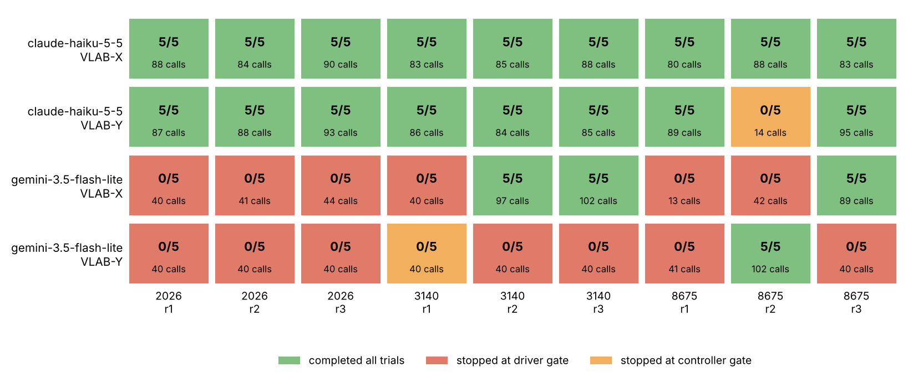
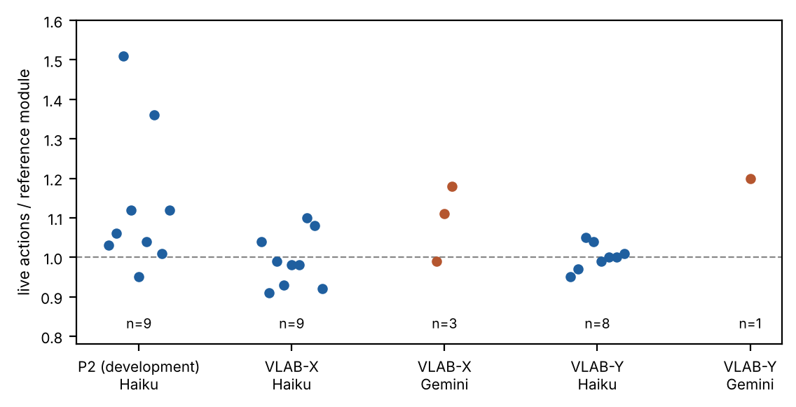

> **Draft status (for internal trial review).** Status: 草擬 (AI-drafted, not yet approved by the authors). Target journal: not chosen; the format is generic. Claims follow `_research/CLAIMS.md` (author-accepted 2026-10-15 and 2026-10-17). Every number traces to a file in `validation/`; derived totals and intervals come from `paper/derive_numbers.py` → `validation/manuscript-derived-2026-10-17.json`. Items marked `[待核實]` still need verification; items marked `[作者決定]` are the authors' decisions.

## Abstract

Connecting a new device to an automation cell usually means writing a communication driver from its manual and then calibrating how its motors move the tool in the camera image. Language models can write such code, but code that runs is not necessarily code that is safe to send to a device. We built a simulated system in which a language-model agent takes over an unfamiliar two-channel pick-and-place device through tool calls. The model reads a manual that contains a protocol specification but no driver template, writes the encode/decode driver, and writes a stateless closed-loop controller that maps camera measurements to motor commands. Before any actuation, the host checks the driver in a dry run against a trusted protocol profile and runs the controller on nine synthetic plants. The task sequence and the image verifier are pre-implemented. We developed the system on two devices (a two-link arm with a JSON-line protocol and a gantry with binary frames), froze it, and then evaluated it on two held-out devices: a CoreXY stage with backlash and a Modbus-RTU-style register protocol, and a five-bar parallel arm. Each condition used 3 seeds × 3 repeats × 5 trials, judged by simulator truth. With claude-haiku-5-5, the model-written drivers and controllers completed 85/90 held-out trials, using 0.91–1.10 times the actions of a hand-written reference controller. With gemini-3.5-flash-lite, they completed 20/90; most of its runs stopped at the driver gate because its drivers kept accepting replies with invalid field values. Across all 36 held-out runs, every run that failed a gate stopped before any device actuation. On the five-bar arm, however, 10 of the 11 controller versions that the gate rejected would have completed the task in offline replay, so gate cases derived from development failures did not transfer to the new kinematics. These are pilot-scale results in simulation; they show the approach can work, and that its success depends strongly on the model.

**Keywords:** language models; code generation; device integration; communication drivers; visual servoing; verification gates; held-out evaluation

## 1 Introduction

Integrating an unfamiliar device into an automation cell involves two kinds of work that are usually done by an engineer. The first is communication: reading the manual, implementing the framing, checksums and reply codes of the wire protocol, and handling error replies. The second is motion: finding out how each motor channel moves the tool in the camera image, which depends on kinematics, mounting and gains that are often undocumented. Both steps are routine for experienced integrators and tedious for everyone else.

Large language models now write useful code for robots, but most of that work assumes the robot is already integrated. Code as Policies [2] and ChatGPT for Robotics [12] have the model compose programs over an existing perception and control API. Work on verifying model-written programs, such as NeSyRo [6], LLM4PLC [11] and test-driven controller refinement [13], wraps generation in checks against a known specification. Work on configuring industrial devices from documentation [8] and on hardware-in-the-loop evaluation of model-written embedded code [10] addresses communication with devices whose sensors and interfaces are known. Learning the motion mapping from images has a long history without language models, from uncalibrated visual servoing [1] to Jacobian fields learned from multi-view video [5].

We study the combination: a language model that, for a device it has not seen, writes both the wire-protocol driver and a closed-loop controller from a manual, camera images and tool feedback, while the host decides whether that code may touch the device. Our literature search was not systematic (Section 2), and we do not claim that this combination has not been studied before.

Two practical questions follow from this setting. First, can the model's code be trusted enough to move a device? We do not trust it: the host runs every driver through a dry-run test and every controller through synthetic isolation cases before actuation, and keeps checking frames and outputs during operation. Second, does a system tuned on some devices work on others? Each design change we made during development was a response to a failure on the development devices, which makes the system easy to overfit. We therefore froze it and evaluated it once on two held-out devices, one with a new protocol family and one with a new kinematic class.

We ask three questions:

- **RQ1.** With no driver template, can a language model write a driver and a controller that pass host-side verification and complete repeated pick-and-place on held-out simulated devices?
- **RQ2.** How strongly does the outcome depend on the model?
- **RQ3.** What do the host-side gates contribute and cost? Do they keep failures away from the device, and do gate cases designed on development devices transfer to new devices?

Our contributions are:

1. **A system** in which a language model writes the driver and the XY controller for an unfamiliar simulated device, with three host-side verification layers: a driver dry run against a trusted protocol profile, isolation tests of the controller on synthetic plants, and run-time checks of every frame, acknowledgement and controller output (Section 3).
2. **An evaluation protocol** with development and held-out devices, a freeze point before held-out evaluation, simulator-truth judging, and deterministic offline replay of every generated controller across seeds (Section 4).
3. **Results** for two models (Section 5). On two held-out simulated devices, evaluated only after the system was frozen, drivers and closed-loop controllers that a language model wrote from manuals, camera images and tool feedback, without a driver template, completed pick-and-place after host-side verification (claude-haiku-5-5: 85/90 trials), but completion depended strongly on the model (gemini-3.5-flash-lite: 20/90). Two observations about the gates are reported with them: runs that failed a gate stopped before any actuation, and controller gate cases built from development failures over-rejected working controllers on the five-bar arm.

## 2 Related work

**Language models that write robot programs.** Code as Policies [2] prompts a language model to write programs that call perception and control primitives, and ChatGPT for Robotics [12] describes prompt and library design for controlling several robots and simulators through high-level functions. VoxPoser [3] uses language and vision-language models to compose 3D value maps that a planner turns into closed-loop trajectories. RACAS [7] controls robots with different embodiments through one agentic system whose inputs include a description of the robot and its available actions. Adaptive code generation for robot control [14] restricts generated programs to a formal library and adds run-time monitoring and replanning. In these systems, as far as their abstracts describe, the robot's command interface is already available to the model. In our setting the model has to produce that interface (the driver) and the low-level motion mapping itself.

**Verifying model-written code before execution.** NeSyRo [6] combines symbolic verification, active exploration and environment checks for code-as-policies task planning. LLM4PLC [11] places grammar checks, a compiler and a model checker around generated PLC programs and reports higher generation success with the verification loop. A test-driven agentic framework [13] repairs generated navigation controllers against a structured test suite in simulation. Our gates belong to this family: generated code must pass host-defined tests before it runs. What differs is the object being tested (a wire-protocol driver and a controller for an unknown mapping) and the question we ask of the gates, namely whether test cases designed on development devices still make the right decisions on held-out devices.

**Devices, documentation and embedded code.** Retrieval-augmented auto-configuration of industrial fieldbus devices [8] generates configurations from device documents and validates them, including a virtual robot-arm case (we have verified only the abstract). Englhardt et al. [10] evaluate model-written embedded programs with hardware in the loop, for example sensor interfaces over I2C, on hardware whose parts are known. CollabIoT [15] uses a language model to turn user intent into access-control policies for devices met in unfamiliar environments. These works are closest on the communication side; none of them, as far as we can tell from their abstracts, combines an unknown wire protocol with unknown kinematics.

**Learning the motion mapping.** Active, uncalibrated visual servoing estimates the image Jacobian from small probing motions [1]. Neural Jacobian Fields [5] learn a visuomotor Jacobian field for diverse robots from multi-view video and then control them from a single camera, and Hu, Lin and Lipson [4] have robots build self-models from images of their own motion. Our controllers are much simpler (two channels, a planar workspace, colour markers) and estimate the local mapping online from their own confirmed history. We do not compare with these methods.

**Real-to-sim-to-real.** Agentic RSR [9] connects scene reconstruction, program policies and execution on a known robot. It is related to the digital-twin direction we mention as future work.

**Search scope.** The references above were found by non-systematic searches and checked at the level of their abstracts or, where noted in our records, their full text. A systematic search is still needed before submission `[待核實]`.

## 3 System

### 3.1 Task and simulated devices

Each simulated device has two unknown XY channels and a known discrete lift (up/down) and gripper (open/closed). A single 640 × 480 camera sees colour markers on the tool tip, the object, a source platform and a destination platform. A run consists of five consecutive pick-and-place trials on one device. Object and destination positions change from trial to trial, and the destination platform height cycles through 0, 0.35, 0.65, 0.35 and 0. The seed sets the scene and the hidden device parameters (link lengths or axis assignment, motor directions, channel mapping, gains, camera angle). None of these parameters are given to the model.

Table 1 lists the four devices. VLAB-P2 and VLAB-G3 were used for development. VLAB-X and VLAB-Y were added as held-out devices, and they are not in the default manual library: they are loaded only with an explicit `--holdout` option, and VLAB-Y is added to the library only in its own experiments.

**Table 1. Simulated devices.** All share the lift and gripper interface, the camera and the markers.

| Device | Role | Mechanism | Protocol | What is new to the model |
|---|---|---|---|---|
| VLAB-P2 | development | planar two-link (2R) arm; mapping rotates with the arm pose | `vlab-p2-json/1`: one JSON object per line, LF-terminated | — |
| VLAB-G3 | development | Cartesian gantry; hidden axis assignment, signs, gains and travel | `vlab-g3-bin/1`: hexadecimal binary frames, `A5` sync byte, length, payload, XOR checksum; int16 × 10⁻⁴; device error codes | — |
| VLAB-X | held out | CoreXY stage: two belt motors jointly drive one carriage (each channel moves both directions); backlash of 0.012–0.02 command units per motor (drawn per seed); acknowledgements report the accepted motor command, not the carriage motion | Modbus-RTU-style registers: unit address 0x11, CRC-16/MODBUS (low byte first), function 0x17 for steps and 0x06 for lift/grip, exception replies; the device stays silent on CRC or address errors | protocol family and belt coupling; the kinematics remain a constant linear channel mix plus a dead zone |
| VLAB-Y | held out | five-bar parallel arm: two base motors drive a closed linkage; the mapping turns and scales with the pose; both motors stop together before a singular configuration and report `limited` | same JSON-line protocol as P2 (different model name, firmware and baud rate) | kinematic class |

On VLAB-X, the device answers every motion command with exception code 6 until it is enabled and homed. The host performs this enable-and-home sequence during the handshake, following the manual, so homing is not something the model did. On VLAB-Y, the task area for each seed is the largest disc that keeps 14° and 24° margins from the singular configurations (radius 107–126 px), and pick and place positions lie at 92% of that radius. Measured with a test script over ten task positions per seed, a channel's image direction on VLAB-Y changes by 85–88° and its gain by up to 2.1 times, whereas on P2 the direction turns through 180° with an almost constant gain. The two arms are nonlinear in different ways; VLAB-Y is not uniformly harder than P2.

### 3.2 Agent loop and tools

The model acts only through tool calls, one per request. During onboarding it can call `inspect_device`, `list_interfaces`, `read_manual`, `connect`, `handshake`, `write_driver`, `test_driver`, `write_controller`, `test_controller` and `start_control` (Figure 1). Each request contains the current camera image, a summary of the onboarding state with recent tool results, and the remaining budgets. After onboarding, each trial follows a fixed step order written by us: raise the lift, open the gripper, move to the object (`select_goal`), lower, close, raise, verify the grasp, move to the destination, lower, release, raise, move clear and verify the placement. At each step the model may only issue the expected step, inspect the scene, or stop. When the model issues `select_goal`, the XY motion to that goal is executed by its own controller, without further model calls per step.

Budgets and limits are part of the system and were not changed for any experiment: at most 40 onboarding decisions; at most two consecutive corrections of an invalid or truncated reply; at most 40 mission decisions and 180 device actions per trial; at most 150 model requests per run; at least 6 s between request starts; a 45 s request timeout. A request that times out or fails with a transient server error (HTTP 500, 502 or 504, or an overload status) is resent once, and HTTP 429 is retried at most twice. Every request actually sent, including retries and correction requests, counts against the budget. Waiting for a model reply never resends a device command.

### 3.3 Generated driver and driver gate

Without a template, the manual for each device contains a description and a machine-readable protocol specification (`protocolSpec`) but no driver source. The model writes a JavaScript module whose `encode` function turns a bounded command (two channel values within ±0.1, or one of four lift/grip commands) into a wire frame, and whose `decode` function turns a device reply into the applied command and a `limited` flag. The module runs in an isolated environment with time limits. The browser build uses an opaque sandboxed iframe with a terminable Worker and no network access; the command-line runner used for all results in this paper uses a Node `vm` context instead (Section 7).

`test_driver` runs six checks (Table 2). All exchanges use the device's dry-run mode, so nothing moves. The host holds a trusted profile of each protocol and uses it as the reference: an encoded frame must parse, under the profile, to exactly the requested command, and a decoded reply must agree with the profile's reading of that reply. The same comparison continues during operation, for every frame and every acknowledgement. An acknowledgement must not exceed or reverse the command, and any disagreement stops the run before another command is sent. A driver may be used only on the connection on which it passed, with the same source hash.

This profile is an oracle that exists because the devices are simulated. In our experiments it measures whether the model's driver is correct, and it is a reason the generated drivers were safe to use. For a device without such a reference, the driver gate would need another source of truth, for example examples in the manual, read-only queries or a protocol analyser (Section 7).

**Table 2. Host-side gates.** Gate 2 cases 7–9 were added during development (versions C–E, Section 5.1); the system was frozen at version E.

| Gate | Check or case | Notes |
|---|---|---|
| 1 Driver dry run | 1. Two-channel round trip at zero, small and limit values | decoded result must equal the device acknowledgement |
| | 2. Encode/decode of the four lift and gripper commands | |
| | 3. Parsing a device `limited` reply | |
| | 4. The driver rejects failed or corrupted replies | `decode` must throw on each fixture; the report does not say which fixture was accepted |
| | 5. Host-side limits block out-of-range and non-finite inputs | |
| | 6. Device-side limit and frame checks | |
| 2 Controller isolation | 1. Rotation 0.3 rad, positive channels | every target must be reached within 60 actions (7 px tolerance) |
| | 2. Channels swapped, channel A reversed | |
| | 3. Large rotation, channel B reversed | |
| | 4. Position-dependent nonlinear mapping | |
| | 5. Recovery when channel A reverses after the first target | |
| | 6. Start near the travel boundary | |
| | 7. Target measurement biased near the goal | added in C; mirrors a development G3 failure |
| | 8. Two-link arm, long-distance multi-target | rotary manuals only; D and E: at most 1.3 × the reference module's actions |
| | 9. Two-link arm, elbow at its limit while detouring | rotary manuals only; added in E; mirrors a development P2 failure |

### 3.4 Generated controller and controller gate

The controller is a stateless function `control(state)`. The state contains the tip and target positions in pixels, the error, the tolerance, the step limit and the last 40 confirmed steps (command sent, amount applied, `limited` flag, image displacement). The function returns a move of two numbers within ±0.1, `verify`, or `stop`. A controller therefore has to estimate the local channel-to-image mapping from its own history and probes. It runs in the same isolated environment as the driver, and an output that is non-finite, out of bounds or malformed stops the run before a command is sent.

`test_controller` runs the controller on the synthetic plants of Table 2. These plants are host-side models, not the evaluated device. Cases 8 and 9 model a two-link arm and are required only when the manual declares rotary channels (P2 and VLAB-Y). For linear devices (G3 and VLAB-X) they are run and reported but do not decide the result. The report gives, for each case, whether it passed, the number of actions, the reason for failure and, where defined, the action ratio to our reference module. `start_control` is accepted only after the driver and the controller have both passed for the current source hashes.

### 3.5 Pre-implemented parts

The task step order, the colour-marker detection, the grasp, transport and placement checks, and the final image verifier are written by us and are the same for all runs. A trial counts as successful for the system when the image shows a grasp, joint motion of tip and object, release, contact with the destination platform at the right height, a placement error of at most 12 px, and the object staying in place after the tool has moved away. During development we changed one image component: the destination is now measured once, at `select_goal`, and then held fixed, because the carried object occluded the destination marker and made the measured goal jump (Section 5.1).

## 4 Evaluation protocol

### 4.1 Development and held-out split

All design choices (prompts, gate cases, thresholds, the reference module) were made on VLAB-P2 and VLAB-G3. Seeds 42 and 7 were used for debugging, and seeds 2026, 3140 and 8675 were used for development evaluations of versions C, D and E. The system was frozen at version E, after the E-version P2 runs. VLAB-X and VLAB-Y were then each evaluated once, under the frozen system, with seeds 2026, 3140 and 8675 × 3 repeats × 5 trials. A seed sets only the scene and the hidden device parameters, and no development result is carried over by reusing the seed values. No result on a held-out device was used to change the gates, prompts, reference module or thresholds.

### 4.2 Pre-specification and amendments

The evaluation plan for each held-out device was written into the project log and committed before its runs. For VLAB-X, the plan was committed at 9af5e12 (2026-10-14 13:50 UTC) and the runs began 2026-10-15 07:46 UTC. For VLAB-Y, the plan was committed at 9d662e1 (2026-10-15 10:43 UTC) and the runs began 2026-10-15 13:07 UTC. The consolidated protocol document (`_research/PROTOCOL.md`, v1.0) was compiled afterwards from these plans and from the conditions actually run. We report it as a post-hoc consolidation of pre-specified plans, and not as a protocol registered in advance. `[作者決定：PROTOCOL v1.0 凍結確認]`

Two amendments were made, both before the results they affect existed:

1. **Freeze point D → E** (2026-10-14). The VLAB-X plan named version D as the freeze point. After D failed on P2 at an elbow limit (Section 5.1), we added gate case 9 (commit dafc752, 2026-10-14 15:49 UTC) and froze at E. No held-out run had started.
2. **Second model** (2026-10-17). We repeated the held-out evaluation with gemini-3.5-flash-lite on the frozen system, with the same devices, seeds, trials, gate, call cap and request interval as the claude-haiku-5-5 runs. At that time the Haiku held-out results were known and no Gemini result existed. The adapter settings were chosen only to match the Haiku runs (Section 4.4).

The design of VLAB-Y was itself motivated by the VLAB-X result: VLAB-X turned out to be kinematically within the linear class that the existing gate cases cover. This influenced what we evaluated, not the system being evaluated. VLAB-Y's proportions were chosen by offline solvability and nonlinearity measurements with our frozen, pre-written controllers only, without any model result.

### 4.3 Conditions

All reported runs use no driver template, model-generated controllers, gate E and five trials per run. Within a run, the five trials share the driver, the controller and the agent's memory, so we report results per run. Runs were never excluded for failure, refusal, invalid replies or budget. The camera images, manual text and tool results go to the agent. Simulator truth and hidden parameters go only to the evaluator.

### 4.4 Models

The models were claude-haiku-5-5 (Anthropic Messages API) and gemini-3.5-flash-lite (Gemini API, paid tier). Both used the same system instructions, apart from naming the tool-call format and a slightly different closing sentence in the user message, and the same output limits of 8192 tokens during onboarding and 1400 afterwards, with thinking tokens included. The settings differ in two ways:

- **Thinking.** Haiku ran with its default adaptive thinking (not set in the request). Gemini ran with `thinkingLevel: medium`. The authors chose this level by principle, to match Haiku's default effort, before any Gemini held-out run. In the first Gemini pilot, the model's default produced no thinking tokens.
- **Tool choice.** Haiku used `auto` with parallel tool calls disabled. Gemini used function-calling mode `ANY`, plus one sentence asking for a single function call.

Two pilots on the development device P2 (seed 2026) checked the Gemini adapter before the held-out runs. They are development data. The first pilot, with the default thinking setting, made 40 calls and completed 0/5 trials, stopping at the driver gate. The second, with medium thinking, made 73 calls and completed 2/5 (Section 5.6). No system setting was changed because of either pilot.

### 4.5 Measures

The primary measure is the number of trials completed, judged by simulator truth: the object placed on the destination, not held, at the platform height. We report it per run (0–5) and in total. Secondary measures:

- **Action ratio:** device actions divided by the actions of our hand-written reference control module on the same seed, run offline with a rule-based driver generated from the specification. The offline baselines in actions are, for seeds 2026/3140/8675, P2 281/277/282, VLAB-X 166/163/165 and VLAB-Y 166/160/179.
- **Gate outcomes:** how many runs passed each gate, how many passed on the first try, and how many tests they needed.
- **Cost:** model calls and tokens.
- **Safety:** unconfirmed actuations, meaning commands sent without a confirmed acknowledgement.
- **Where each run stopped.**

### 4.6 Offline replay

Generated controllers are stateless functions of their inputs, and the simulator is deterministic for a given seed. So every controller can be replayed offline (`tests/replay_controller.cjs`), with a rule-based policy taking the high-level steps. We use replay in two ways. For every completed run, we replay the controller over five trials on all three seeds; a replay on the run's own seed must reproduce the live action count. For analysis only, we replay controller versions that the gate rejected (`--ignore-gate`), to see whether each rejection stopped a controller that would have failed. Replays are never counted as live results.

### 4.7 Statistics

As planned, we do not test hypotheses: with 9 runs per device and model, such tests would say little. We report counts, per-run values and ranges. For orientation, we add 95% Clopper–Pearson intervals for the proportion of runs that completed all five trials. These intervals were not pre-specified, and they treat runs as independent, which repeated seeds only approximate.

## 5 Results

### 5.1 Development history (VLAB-P2 and VLAB-G3; development data)

The gate grew from six cases to nine. Each case added after the original six (cases 7–9 in Table 2) codifies a failure we saw on a development device. All runs in this subsection used claude-haiku-5-5 on development seeds, so they are development data and not evidence of generalization.

- **Version C.** In an earlier batch, a G3 run completed 0/5. The carried object occluded the destination marker, the measured goal jumped between two positions, and the controller's undamped step chased it until the 180-action cap. Version C fixed the destination measurement at `select_goal` (Section 3.5), added case 7, and made case 8 required on rotary manuals, where it had only been reported. Over three repeats per seed, P2 completed 36/45 trials and G3 44/45. Every unfinished trial was a request timeout, a provider error or a batch budget stop, not a control failure. The nine G3 controllers used 0.89–1.01 times the reference actions. The nine P2 controllers had a median ratio of 1.11, and 3 of 9 exceeded 1.3 (full five-trial replays were used where a run was interrupted).
- **Version D.** The three slow P2 controllers all had two-link case ratios of 1.33–1.48; the other six had 0.87–1.23. Version D made case 8 fail above 1.3 times the reference actions. Under D, two P2 runs on seed 3140 failed in trial 3: with the elbow at its travel limit, both controllers discarded `limited` samples, so their local mapping could not be refitted, and the arm circled the base until the 180-action cap. Four further D runs were interrupted because two batches had shared one local bridge and its call cap by mistake, which was a procedural error. In total, D completed 26/45 P2 trials over nine runs.
- **Version E.** Case 9 reproduces the D failure geometry. We checked it before any live E run by replaying all 16 distinct P2 controllers collected under C and D on three seeds. Among the 13 controllers that gate D accepts, case 9 rejected exactly the 3 that fail the full task on some seed and accepted all 10 that complete every seed. This check is in-sample: the case was built from one of those failures. Live, version E completed 45/45 P2 trials over 9/9 runs. Case 9 rejected a first draft in 3 runs, and the model rewrote the controller each time. Action ratios had a median of 1.06 and a range of 0.95–1.51, with 2 of 9 above 1.3. Four transient request failures were absorbed by the single resend. All 27 cross-seed replays completed.

Table 3 summarizes the P2 versions.

**Table 3. VLAB-P2 development versions (claude-haiku-5-5, 9 runs each, seeds 2026/3140/8675 × 3).**

| Version | Live trials completed | Runs ended by control failure | Runs interrupted (infrastructure or procedure) | Action ratio of full controllers |
|---|---|---|---|---|
| C | 36/45 | 0 | 3 | median 1.11; 3/9 above 1.3 |
| D | 26/45 | 2 | 4 | — (partial) |
| E | 45/45 | 0 | 0 | median 1.06 (0.95–1.51); 2/9 above 1.3 |

### 5.2 Held-out devices: overall outcome

Tables 4 and 5 and Figure 2 give the held-out results. With claude-haiku-5-5, 17 of 18 runs completed all five trials, for 85/90 trials in total (95% interval for the run proportion 0.727–0.999). With gemini-3.5-flash-lite, 4 of 18 runs completed, for 20/90 trials (0.064–0.476). Every completed run completed all five of its trials; every other run stopped during onboarding.

**Table 4. Held-out outcomes (frozen version E; 9 runs per row; seeds 2026/3140/8675 × 3; 5 trials per run).** Haiku = claude-haiku-5-5; Gemini = gemini-3.5-flash-lite.

| Model | Device | Runs completed (95% CI) | Trials | Action ratio, completed runs | Runs stopped at a gate |
|---|---|---|---|---|---|
| Haiku | VLAB-X | 9/9 (0.664–1.000) | 45/45 | median 0.98 (0.91–1.10) | — |
| Haiku | VLAB-Y | 8/9 (0.518–0.997) | 40/45 | median 1.00 (0.95–1.05) | controller 1 |
| Gemini | VLAB-X | 3/9 (0.075–0.701) | 15/45 | 0.99, 1.11, 1.18 | driver 6 |
| Gemini | VLAB-Y | 1/9 (0.003–0.482) | 5/45 | 1.20 | driver 7, controller 1 |

The confidence intervals were not pre-specified (Section 4.7).

**Table 5. Onboarding and cost of the held-out runs.** Output tokens include thinking tokens.

| Model | Device | Driver gate passed (first try) | Controller gate first try | Model calls | Tokens in / out |
|---|---|---|---|---|---|
| Haiku | VLAB-X | 9/9 (8/9) | 4/9 | 769 | 3,851,126 / 370,375 |
| Haiku | VLAB-Y | 9/9 (0/9) | 2/9 | 721 | 3,670,881 / 367,167 |
| Gemini | VLAB-X | 3/9 (0/9) | 0/3 | 508 | 3,240,659 / 639,247 |
| Gemini | VLAB-Y | 2/9 (0/9) | 0/2 | 423 | 2,642,711 / 434,467 |

None of the 15 failed held-out runs actuated the device: 13 stopped at the driver gate and 2 at the controller gate, all with zero device actions. There were no unconfirmed actuations in any held-out run. No completed run had a control failure during its trials.

### 5.3 claude-haiku-5-5 on the held-out devices

**VLAB-X.** All 9 runs completed 5/5, with 80–90 model calls per run. Eight drivers passed the Modbus-style driver test on the first try, which covers CRC, unit address, exception replies and a silent device. One driver failed twice on lift/grip encoding before passing. Controllers needed 17 gate tests in total, and 4 of 9 passed on the first try; the most frequent rejection was the start near the travel boundary (5 runs). Two transient request failures were absorbed. The run-level ratio of 0.91–1.10 is close to the reference module. Because VLAB-X is kinematically a linear channel mix, this result speaks to the new protocol family and the belt coupling, not to new kinematics.

**VLAB-Y.** Eight of 9 runs completed 5/5 (40/45 trials). No driver passed on the first try: all nine first drivers accepted a failed or corrupted reply, and all nine second drivers passed. In earlier development runs on P2, which uses the same protocol, Haiku's first drivers failed the same check, so this looks like a habit of the model with this protocol family rather than an effect of the five-bar arm. Controllers needed 19 gate tests, and 2 of 9 passed on the first try. The elbow-limit case 9 rejected a version in 5 runs. No XY acknowledgement during the trials was `limited`, so the tasks never reached the singularity margin and the device's singularity stop was not exercised.

The failed run (seed 8675, repeat 2) stopped after 14 calls. Its first controller failed only case 9. In rewriting it, the model added a rule that reversed the step whenever the last accepted amount was at least 0.09. Since a normal full step is 0.1, the rule reversed every step, and the second version failed all nine cases. The model then stopped, stating that `write_controller` was not among the allowed tools, although it was available and had been used two steps earlier. No command reached the device.

### 5.4 gemini-3.5-flash-lite on the held-out devices

**Where the runs stopped.** Thirteen of 18 runs stopped at the driver gate. In 12 of them the driver repeatedly failed check 4 (rejecting failed or corrupted replies) until the 40-decision onboarding limit ended the run. One VLAB-X run (seed 8675, repeat 1) ended after 13 calls, when three consecutive replies were truncated and the correction limit was reached. One VLAB-Y run (seed 3140, repeat 1) passed the driver gate but failed its first controller test and then reached the onboarding limit.

**What the drivers got wrong.** We decoded every driver version offline against the fixture replies (Table 6). The Gemini drivers nearly always rejected structural errors: bad CRC, wrong address, exception codes, non-JSON text, `ok:false`. What they accepted were replies that were well-formed but carried invalid values. On VLAB-X, 94 of 99 driver versions accepted a write reply whose lift value was 7. On VLAB-Y, 145 of 150 accepted a reply whose accepted channel value was not a number, and 145 accepted a lift position of `sideways`. The gate's feedback says that the driver must reject failed or corrupted replies, but not which reply it accepted; Haiku received the same feedback text. The VLAB-X driver contract states explicitly that corrupted replies must throw, and the failure persisted there as well, so it is not explained by the wording of the P2-family manual alone.

**Table 6. Offline check of every Gemini driver version against the gate's fixture replies.**

| Device | Driver versions checked | Accepted an invalid reply (most frequent) | Runs that passed the driver gate |
|---|---|---|---|
| VLAB-X | 99 | 94 accepted a lift value of 7 | 3/9 |
| VLAB-Y | 150 | 145 accepted a non-numeric channel value and a lift position `sideways` | 2/9 |

**Truncation.** Thirteen Gemini replies were truncated (12 on VLAB-X, 1 on VLAB-Y), all during onboarding, when the reply ran into the 8192-token output limit. In the 12 truncations with a trace record, thinking alone used 6,394–7,864 tokens. As the amendment required, the limit was not raised, and truncations counted as invalid replies. Haiku had no truncations under the same limit.

**Completed runs.** The four completed Gemini runs had ratios of 0.99, 1.11 and 1.18 (VLAB-X) and 1.20 (VLAB-Y). Their controllers completed every cross-seed replay (9/9 on VLAB-X, 3/3 on VLAB-Y), with own-seed replays equal to the live counts.

### 5.5 Gate decisions in hindsight

Table 7 reports the replay analysis of controller versions that the gate rejected on held-out devices. On VLAB-Y, 10 of the 11 versions rejected in Haiku runs would have completed five trials on all three seeds. The one exception is the broken second version described in Section 5.3. Five of these rejections were due only to the elbow-limit case 9, which was built from a P2 failure. For Gemini, all 3 rejected versions on VLAB-X and 2 of 3 on VLAB-Y would have completed. The remaining one fails every seed, so that rejection was correct.

**Table 7. Controller versions rejected by the gate on held-out devices, replayed offline with the gate ignored (analysis only).**

| Model, device | Rejected versions | Would complete on all three seeds | Rejected only by case 9 |
|---|---|---|---|
| claude-haiku-5-5, VLAB-Y | 11 | 10 | 5 |
| gemini-3.5-flash-lite, VLAB-X | 3 | 3 | 0 |
| gemini-3.5-flash-lite, VLAB-Y | 3 | 2 | 0 |

Rejected versions from the Haiku VLAB-X runs were not replayed, so they are not in the table.

The gate is also not complete on the development device. In the second Gemini pilot on P2, a controller passed all nine cases, including case 9, yet oscillated at a travel limit in trial 3. Offline replay reproduced that failure on seed 2026 (59/53/180 actions over three trials) and showed the controller completing seeds 3140 and 8675 (289 and 283 actions; reference 277 and 282). So the agreement between case 9 and full replay found for Haiku's 16 P2 controllers (Section 5.1) does not hold for every controller.

### 5.6 Efficiency and cross-seed replay

Figure 3 shows the action ratios of completed runs. Haiku's held-out controllers stay within 0.91–1.10 of the reference module, which is narrower than its P2 range of 0.95–1.51 under the same gate. All cross-seed replays of completed controllers finished five trials: 27/27 for Haiku on P2, 27/27 on VLAB-X and 24/24 on VLAB-Y; 9/9 and 3/3 for Gemini. Every own-seed replay reproduced the live action count. Only device actions are compared. Wall-clock time and model calls during the mission are not included in the ratio.

### 5.7 Cost

Haiku used 80–95 calls per completed held-out run and, per call, 5,008–5,091 input and 482–509 output tokens. Gemini used 6,248–6,379 input and 1,027–1,258 output tokens per call; thinking accounted for 444,798 (VLAB-X) and 345,951 (VLAB-Y) output tokens in total. At the list prices used for budgeting (US$0.30 per million input tokens and US$2.50 per million output tokens, including thinking), the Gemini held-out runs are estimated at US$4.45, and US$4.79 including the two pilots. Cached tokens were counted at full price, so the bill should not exceed this estimate. Haiku token use was not converted to a price. `[作者決定：是否報告 Haiku 費用]`

## 6 Discussion

**The approach can work, and the model decides much of whether it does (RQ1, RQ2).** With claude-haiku-5-5, the frozen system handled a Modbus-style protocol with CRC on a coupled-belt stage (45/45 trials) and a five-bar arm with pose-dependent mapping (40/45 trials). Its controllers were about as efficient as our hand-written reference. With gemini-3.5-flash-lite on the same devices, gates and budgets, most runs never got past the driver. Our data do not tell us why the two models differ, and the settings were not identical: thinking mode, tool-choice mode and truncation under a shared output limit all differ (Section 4.4). We therefore report two models, each with one setting, and do not generalize to other models or providers.

**Gates moved failures away from the device, but did not create capability (RQ3).** In all 36 held-out runs, a failure meant a run that stopped during onboarding, with model calls spent and no device action. This matters for the intended use, where a wrong frame or an unstable controller could damage hardware. The gates did not help the weaker model succeed, however. Its drivers failed the same check in 242 of 247 driver tests. The feedback says that some failed or corrupted reply was accepted, not which one, and the model never added checks on field values. Haiku, given the same text, fixed its JSON-line drivers in one round. During development we saw how much the content of feedback matters. When case 8 only reported the controller's efficiency ratio, the model did not change a slow controller. When D made the ratio a pass condition and stated it in the feedback, the two first drafts it rejected at 1.42 were rewritten to 0.97 and 1.07, and their live runs used 0.99 and 1.08 times the reference actions. More specific driver feedback might help weaker models. Because the system is frozen, that is a hypothesis for a new version, not a result.

**Gate cases built from development failures did not transfer (RQ3).** On P2, case 9 separated failing from working controllers among Haiku's 16 P2 controllers, but that check was in-sample. On VLAB-Y it rejected working controllers. Over both models, 12 of the 14 controller versions rejected on VLAB-Y would have completed. The extra rewrites cost calls, and in one run a rewrite broke a working controller and the run ended. The case encodes a property of a serial two-link arm (an elbow folding onto its limit), and the manual's `rotary` label made it required on a parallel mechanism where that property does not hold in the same way. In addition, a Gemini controller passed case 9 on P2 and still failed there. A fixed set of synthetic cases is therefore neither complete on the device it was built from nor transferable to a new mechanism. Possible designs include cases selected per mechanism class, a split between required and report-only cases, or replay on a simulator of the actual device where one exists. Each would need its own held-out evaluation. Because of this observation, the VLAB-Y result describes the gate and the model together, not the model's control ability alone.

**Replay is a cheap check.** Because a controller is a stateless function, replaying it offline reproduced every live action count and made two analyses free of model cost: whether a controller that worked on one seed also works on others (all completed controllers did under version E), and whether a rejected controller would have failed (Table 7). Under version C, replay found a controller that had succeeded live on one seed but failed trial 3 on two others. We suggest offline replay as a standard part of evaluating generated controllers when the system is deterministic.

## 7 Limitations

- **Simulation only, with devices designed by us.** All four devices are simulated and share the lift and gripper interface, the camera and the colour markers. Only two are held out: one is new in protocol family and the other in kinematic class. Nothing here shows control of arbitrary unknown devices, unknown Z or six-axis motion, physical hardware, or more than one workstation.
- **The host knows the protocol.** The driver gate and the run-time checks compare the model's driver with a trusted protocol profile held by the host. For a truly unknown device such a reference would usually be missing, so our results measure whether the model can write a correct driver, verified against an oracle. They do not show that model-written drivers can be used safely without one.
- **Much of the task is pre-implemented.** The task step order, image measurement, grasp and placement checks, and the final verifier are written by us; in the mission phase the model mainly issues the expected next step. On VLAB-X the host, not the model, performs the enable-and-home sequence.
- **Two models with non-equivalent settings.** Each model was run with one setting, and the settings differ in thinking mode and tool-choice mode. Gemini's thinking counted against the same output limit and caused 13 truncations. Neither model is a larger or smaller member of the same family, so we cannot separate model scale from provider.
- **Small samples.** Each condition has 3 seeds × 3 repeats. Trials within a run are not independent. The intervals in Table 4 are post hoc and wide.
- **The gate was tuned on development failures.** Versions C–E were built from failures on P2 and G3 with the same seed values that later served for held-out devices. The held-out devices were evaluated once, after the freeze, and there was no live run without the gate on them. The singularity stop of VLAB-Y was never triggered.
- **Held-out design choices.** VLAB-Y was designed after we interpreted the VLAB-X result, and its proportions were selected using our frozen reference controllers. The device may therefore lean toward problems that those controllers can solve.
- **Post-hoc protocol document.** The evaluation plans were committed before the runs (Section 4.2), but the consolidated protocol was written afterwards.
- **No comparison with published methods.** The rule-based driver generator, the reference control module and the built-in controller all use designer knowledge. They are references for solvability and efficiency, not competing methods, and the efficiency comparison covers device actions only.
- **Execution environment.** All reported runs used the command-line runner, which isolates generated code in a Node `vm` context. That context is not a security boundary, unlike the iframe and Worker sandbox of the browser build. Runs were made on one workstation.
- **Model versions change.** Cloud models change over time, so exact reproduction is not guaranteed. We record model identifiers, dates, commits and every generated source.

## 8 Conclusion

We built a simulated system in which a language model writes the communication driver and the closed-loop controller for an unfamiliar device, while host-side gates decide whether that code may run. We evaluated it, after freezing it, on two held-out devices. With claude-haiku-5-5 the generated code completed 85 of 90 held-out pick-and-place trials, about as efficiently as a hand-written controller. With gemini-3.5-flash-lite it completed 20 of 90, because the model could not repair its drivers from the gate's feedback. In every held-out run, failures stopped before the device moved. Gate cases derived from development failures, however, rejected working controllers on a new mechanism and missed a failing one on a development device. The results support the feasibility of language-model-written device integration under host verification, and show a strong dependence on the model, at pilot scale in simulation. Next steps are gate designs that transfer across mechanism classes, more specific feedback, more models and settings, devices without a host-side protocol oracle, and physical hardware.

## Statements

**AI use.** The system under study uses language models (claude-haiku-5-5 and gemini-3.5-flash-lite) as described in Sections 3–4. Separately, the authors used Claude Code (Anthropic) `[作者填寫：使用的模型版本]` as an AI coding and writing assistant. It implemented parts of the software and tests, ran offline analyses and replays, and drafted this manuscript from the project records. The authors chose the research direction, the devices, the freeze point, the protocol amendments and the wording of all claims, and they take responsibility for the content. All numbers were checked against the run records with a script (`check_numbers.py`). AI tools are not authors.

**Data and code availability.** The simulator, devices, gates, replay tools, run summaries (including every generated driver and controller source) and analysis scripts are in the project repository `[待核實：公開網址與授權；建議投稿時建立封存 DOI]`. Full run exports (13–29 MB each) are held by the authors and can be shared on request `[作者決定]`.

**Funding.** `[作者填寫]`

**Competing interests.** `[作者填寫；注意：被評估模型之一與撰寫輔助工具來自同一公司 (Anthropic)；Haiku 的 API 額度來源請一併說明]`

**Author contributions.** `[作者填寫]`

## References

[1] B. H. Yoshimi and P. K. Allen, "Active, uncalibrated visual servoing," in *Proc. IEEE International Conference on Robotics and Automation (ICRA)*, 1994. `[待核實：頁碼]`

[2] J. Liang et al., "Code as Policies: Language Model Programs for Embodied Control," arXiv:2209.07753, 2022.

[3] W. Huang et al., "VoxPoser: Composable 3D Value Maps for Robotic Manipulation with Language Models," arXiv:2307.05973, 2023.

[4] Y. Hu, J. Lin and H. Lipson, "Teaching robots to build simulations of themselves," *Nature Machine Intelligence*, 2025. doi:10.1038/s42256-025-01006-w. `[待核實：卷期頁]`

[5] S. L. Li et al., "Controlling diverse robots by inferring Jacobian fields with deep networks," *Nature*, 2025. doi:10.1038/s41586-025-09170-0. `[待核實：作者名縮寫與卷期頁]`

[6] S. Ahn et al., "Towards Reliable Code-as-Policies: A Neuro-Symbolic Framework for Embodied Task Planning," arXiv:2510.21302, 2025.

[7] Ashley et al., "RACAS: Controlling Diverse Robots With a Single Agentic System," arXiv:2603.05621, 2026. `[待核實：作者名]`

[8] Ganie, Ezzini and Marazi, "RAG-Based Auto-Configuration for Industrial Fieldbus Devices," arXiv:2608.08618, 2026. `[待核實：作者名；僅核實摘要]`

[9] Li et al., "Agentic RSR: Real-to-Sim-to-Real through Scene Reconstruction and Execution-Grounded Robot Policies," arXiv:2610.10479, 2026. `[待核實：作者名]`

[10] Z. Englhardt et al., "Exploring and Characterizing Large Language Models For Embedded System Development and Debugging," arXiv:2307.03817, 2023. `[待核實：CHI EA 2024 版本]`

[11] M. Fakih et al., "LLM4PLC: Harnessing Large Language Models for Verifiable Programming of PLCs in Industrial Control Systems," in *Proc. ICSE-SEIP*, 2024. arXiv:2401.05443.

[12] S. Vemprala et al., "ChatGPT for Robotics: Design Principles and Model Abilities," Microsoft Technical Report MSR-TR-2023-8, 2023. arXiv:2306.17582.

[13] Tripathi, Akbarian Bafghi and Raissi, "Test-Driven Agentic Framework for Reliable Robot Controller," arXiv:2603.00455, 2026. `[待核實：作者名]`

[14] Flerlage, Wittkopp, Acker and Kao, "Adaptive Code Generation for Controlling Robots," in *Proc. ISoLA*, 2026. arXiv:2610.09588. `[待核實：作者名與頁碼]`

[15] Shastri et al., "LLM-Driven Auto Configuration for Transient IoT Device Collaboration," arXiv:2507.03064, 2025. `[待核實：發表場合]`

## Appendix A. Number sources

| Item | Record (all in `validation/`) |
|---|---|
| P2 version E (Table 3, Section 5.1) | `live-cli-batch-E-2026-10-15.json` |
| P2 versions C and D (Table 3) | `live-cli-batch-C-2026-10-14.json`, `live-cli-batch-C-repeats-2026-10-14.json`, `live-cli-batch-C-repeats2-2026-10-14.json`, `live-cli-batch-D-2026-10-14.json`, `live-cli-batch-D2-2026-10-14.json` |
| Gate E check on 16 P2 controllers | `v70-gate-e.json` |
| Haiku VLAB-X, VLAB-Y (Tables 4, 5, 7) | `live-cli-holdout-X-2026-10-15.json`, `live-cli-holdout-Y-2026-10-15.json` |
| Gemini VLAB-X, VLAB-Y (Tables 4–7) | `live-cli-holdout-gemini-X-2026-10-17.json`, `live-cli-holdout-gemini-Y-2026-10-17.json` |
| Gemini pilots (Sections 4.4, 5.5) | `live-cli-pilot-gemini-P2-2026-10-17.json`, `live-cli-pilot2-gemini-P2-2026-10-17.json` |
| Offline baselines | `v7x-offline-baseline.json`, `v7y-offline-baseline.json`, `live-cli-batch-C-repeats2-2026-10-14.json` (P2) |
| Totals, intervals, figures | `manuscript-derived-2026-10-17.json` (from `paper/derive_numbers.py`) |
